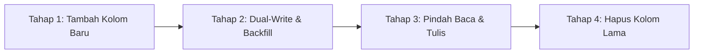

# Panduan Deployment & Migrasi Produksi — Frasa Klausa Media

Dokumen ini mendokumentasikan prosedur standar operasional (SOP) untuk deployment aplikasi, manajemen lingkungan Vercel, migrasi basis data Supabase yang aman, strategi rollback aplikasi, pemulihan data (*disaster recovery*), pembuatan akun Super Admin produksi, hingga konfigurasi domain dan SEO.

Referensi PRD: **§21 (Git & Code Review)**, **§22 (CI/CD & Deployment)**, **§25 (Checklist Sebelum Selesai)**, dan **§26 (Scope v1.0)**.

---

## 1. Pemisahan Lingkungan Vercel (Development, Preview, Production)

Platform deployment Frasa Klausa Media menggunakan **Vercel**. Seluruh konfigurasi variabel lingkungan wajib dipisahkan secara ketat ke dalam 3 target lingkungan:

| Variabel Lingkungan | Lingkup Akses | Development | Preview (PR / Staging) | Production (Live) |
| :------------------ | :------------ | :---------- | :--------------------- | :---------------- |
| `NEXT_PUBLIC_SUPABASE_URL` | Publik (Browser & SSR) | Project Dev Supabase | Project Staging Supabase | Project Prod Supabase |
| `NEXT_PUBLIC_SUPABASE_ANON_KEY` | Publik (Browser & SSR) | Anon key Dev | Anon key Staging | Anon key Prod |
| `SUPABASE_SERVICE_ROLE_KEY` | **Rahasia (Server Saja)** | Service role key Dev | Service role key Staging | Service role key Prod |
| `NEXT_PUBLIC_APP_URL` | Publik | `http://localhost:3000` | `https://[branch-preview].vercel.app` | `https://frasaklausamedia.com` |
| `CRON_SECRET` | **Rahasia (Server Saja)** | Rahasia Dev lokal | Rahasia Preview | String acak berkekuatan tinggi (min 32 karakter) |

> [!CAUTION]
> **Audit Keamanan Variabel Lingkungan:**
> 1. Jangan pernah memberikan prefix `NEXT_PUBLIC_` pada `SUPABASE_SERVICE_ROLE_KEY` atau `CRON_SECRET`.
> 2. Kunci `SUPABASE_SERVICE_ROLE_KEY` memiliki hak bypass RLS penuh. Pastikan variabel ini **hanya** dicentang untuk lingkungan *Production* dan *Preview* pada dashboard Vercel (**Settings -> Environment Variables**).
> 3. Jangan pernah melakukan commit file `.env.local` ke repositori Git. Gunakan `env.example` sebagai referensi struktur.

### Konfigurasi Vercel Cron (`vercel.json`)
Sesuai PRD §10.12 dan PRD §26, project menggunakan cron keep-alive untuk mencegah Supabase auto-pause:
```json
{
  "$schema": "https://openapi.vercel.sh/vercel.json",
  "crons": [
    {
      "path": "/api/keep-alive",
      "schedule": "0 3 */5 * *"
    }
  ]
}
```
*Catatan:* Vercel Cron **hanya aktif otomatis pada deployment target Production**. Request cron dari Vercel otomatis mengirimkan header `Authorization: Bearer <CRON_SECRET>` yang diverifikasi di endpoint `/api/keep-alive`.

---

## 2. Prosedur Aman Migrasi Basis Data Produksi

Migrasi skema database dijalankan secara terurut menggunakan script SQL bernomor di `src/migrations/`.

### Urutan Standar Eksekusi (Additive First)
Setiap deployment yang melibatkan perubahan skema database harus mengikuti urutan berikut:
1. **Langkah 1: Backup Database**: Ambil snapshot/dump sebelum menjalankan DDL apa pun.
2. **Langkah 2: Terapkan Migrasi Skema (Additive)**: Jalankan migrasi baru di database produksi **SEBELUM** kode aplikasi baru dideploy.
3. **Langkah 3: Deploy Kode Aplikasi**: Rilis versi aplikasi baru di Vercel yang memanfaatkan skema baru tersebut.
4. **Langkah 4: Smoke Test**: Verifikasi operasi baca dan tulis pada modul terkait.

### Pola 4-Tahap untuk Perubahan Breaking (Zero-Downtime Rollout)
Jika terdapat perubahan struktur yang tidak backward-compatible (misalnya penggantian nama kolom, restrukturisasi tabel, atau perubahan tipe data), dilarang melakukan `ALTER TABLE DROP COLUMN` atau penggantian nama kolom secara langsung dalam satu langkah. Gunakan pola 4 tahap:



1. **Tahap 1 (Additive Structure):**
   - Buat kolom/tabel baru dengan sifat *nullable* atau memiliki *default value*.
   - Jalankan migrasi di database produksi.
2. **Tahap 2 (Backfill Data):**
   - Jalankan script kueri update/backfill untuk menyalin data historis dari kolom lama ke kolom baru.
   - Buat trigger sinkronisasi sementara jika diperlukan.
3. **Tahap 3 (Switch Read/Write):**
   - Deploy versi kode aplikasi baru yang menulis dan membaca ke struktur baru.
   - Pantau log error dan kestabilan sistem selama minimal 24-48 jam.
4. **Tahap 4 (Deprecate & Drop):**
   - Buat file migrasi terpisah (misal `010_drop_deprecated_column.sql`) untuk menghapus kolom lama setelah dipastikan tidak ada lagi traffic yang mengaksesnya.

---

## 3. Strategi Backup, Rollback & Disaster Recovery

### Protokol Backup Sebelum Migrasi
Sebelum mengeksekusi migrasi apa pun di database produksi Supabase:
1. **Manual Backup via Supabase CLI / pg_dump:**
   ```bash
   pg_dump -h db.<PROJECT_REF>.supabase.co -U postgres -d postgres -F c -b -v -f "backup_prod_$(date +%Y%m%d_%H%M%S).dump"
   ```
2. **Snapshot via Dashboard Supabase:**
   - Masuk ke **Database -> Backups**.
   - Verifikasi bahwa automated backup harian terakhir dalam status sehat (*healthy*).

### Strategi Rollback Aplikasi (Vercel Instant Rollback)
Jika kode aplikasi yang baru dideploy mengalami error fatal atau regresi fungsional di production:
1. Buka dashboard Vercel: **Deployments**.
2. Cari deployment sebelumnya yang stabil (sebelum rilis bermasalah).
3. Klik ikon menu tiga titik `...` pada deployment stabil tersebut -> pilih **Instant Rollback**.
4. Vercel akan langsung mengarahkan traffic domain produksi ke artefak build stabil sebelumnya dalam hitungan detik tanpa perlu melakukan rebuild Git.

### Strategi Pemulihan Data (*Data Recovery*)
1. Jika terjadi kesalahan data akibat kueri yang salah:
   - Gunakan fitur **Point-in-Time Recovery (PITR)** di Supabase Pro/Team untuk merestore state database ke menit tepat sebelum insiden terjadi.
2. Jika perlu merestore dump lokal:
   ```bash
   pg_restore -h db.<PROJECT_REF>.supabase.co -U postgres -d postgres -v -c "backup_prod_YYYYMMDD_HHMMSS.dump"
   ```

---

## 4. Setup Super Admin Produksi & Isolasi Seed Dummy

### Penonaktifan Seed Dummy di Produksi
File `src/migrations/004_seed.sql` dirancang khusus untuk keperluan pengembangan lokal (data mock buku, kategori, artikel, dan banner promo contoh).
> [!WARNING]
> **DILARANG** menjalankan file `src/migrations/004_seed.sql` pada basis data produksi!
> Database produksi hanya menjalankan skema struktural:
> - `001_initial_schema.sql`
> - `002_functions_and_rpc.sql`
> - `003_rls_and_storage.sql`
> - `005_rate_limits.sql`
> - `006_fix_profile_privilege_bootstrap.sql`
> - `007_book_images_alt_and_atomic_rpc.sql`
> - `008_posts_reading_time.sql`
> - `009_accounts_settings_and_audit_logs.sql`

### Prosedur Pembuatan Akun Super Admin Produksi
Untuk menjaga keamanan kredensial, akun Super Admin awal di produksi **tidak boleh menggunakan password default** dan **tidak boleh dicatat di kode repositori**.

Jalankan skrip berikut di **Supabase SQL Editor** produksi dengan mengganti parameter `prod_email` dan `prod_password` secara langsung di editor:

```sql
-- Pastikan pgcrypto aktif
CREATE EXTENSION IF NOT EXISTS pgcrypto;

DO $$
DECLARE
  super_admin_id uuid := gen_random_uuid();
  -- GANTI EMAIL DAN PASSWORD DI BAWAH INI DENGAN KREDENSIAL ASLI PRODUKSI (MIN 12 KARAKTER)
  prod_email text := 'superadmin@frasaklausamedia.com';
  prod_password text := 'GantiDenganPasswordSuperAdminSangatKuat!2026';
  prod_name text := 'Super Administrator Frasa Klausa';
BEGIN
  IF NOT EXISTS (SELECT 1 FROM auth.users WHERE email = prod_email) THEN
    INSERT INTO auth.users (
      instance_id,
      id,
      aud,
      role,
      email,
      encrypted_password,
      email_confirmed_at,
      raw_app_meta_data,
      raw_user_meta_data,
      created_at,
      updated_at
    ) VALUES (
      '00000000-0000-0000-0000-000000000000',
      super_admin_id,
      'authenticated',
      'authenticated',
      prod_email,
      crypt(prod_password, gen_salt('bf', 12)),
      now(),
      '{"provider":"email","providers":["email"]}'::jsonb,
      jsonb_build_object('full_name', prod_name, 'role', 'super_admin'),
      now(),
      now()
    );

    UPDATE public.profiles
    SET 
      full_name = prod_name,
      role = 'super_admin'::user_role,
      is_active = true
    WHERE id = super_admin_id;

    RAISE NOTICE 'Akun Super Admin Produksi berhasil dibuat: %', prod_email;
  ELSE
    RAISE NOTICE 'Akun dengan email % sudah terdaftar.', prod_email;
  END IF;
END $$;
```

Setelah akun Super Admin produksi berhasil login ke `/login`, pembuatan akun Admin staf lainnya dilakukan langsung melalui antarmuka **CMS Admin -> Pengguna** (`/admin/users`) via modal pembuatan akun yang aman (PRD §6.1).

---

## 5. Domain, HTTPS, HSTS, dan Google Search Console

### Konfigurasi Custom Domain & HTTPS
1. Pada dashboard Vercel, masuk ke **Settings -> Domains**.
2. Tambahkan domain produksi utama: `frasaklausamedia.com` dan `www.frasaklausamedia.com`.
3. Atur DNS Record pada registrar domain:
   - Tipe `A`: `@` -> `76.76.21.21`
   - Tipe `CNAME`: `www` -> `cname.vercel-dns.com`
4. Vercel otomatis menerbitkan sertifikat SSL/TLS gratis via Let's Encrypt / DigiCert.

### Verifikasi HSTS (HTTP Strict Transport Security)
Header HSTS telah dikonfigurasi di `next.config.ts`:
```ts
{
  key: 'Strict-Transport-Security',
  value: 'max-age=63072000; includeSubDomains; preload'
}
```
*Aturan:* HSTS hanya diaktifkan ketika aplikasi berjalan pada mode produksi (`NODE_ENV === 'production'`) dan sertifikat SSL/TLS custom domain telah aktif 100%.

### Pendaftaran Google Search Console (GSC)
1. Buka [Google Search Console](https://search.google.com/search-console).
2. Tambahkan Properti Domain `frasaklausamedia.com` (verifikasi via DNS TXT Record).
3. Setelah terverifikasi, masuk ke menu **Sitemaps**.
4. Masukkan URL sitemap kanonikal: `https://frasaklausamedia.com/sitemap.xml`.
5. Klik **Submit** dan pantau indeksasi seluruh URL publik (buku, blog, kategori, beranda, tentang kami, kontak).

### Audit Isolasi Privasi (Robots.txt & Noindex)
Aplikasi memastikan area privat tidak terindeks oleh search engine:
- `robots.txt` melarang perayapan pada `/admin/*`, `/login`, dan `/api/*`.
- Layout admin (`src/app/(admin)/admin/layout.tsx`) dan halaman login (`src/app/(auth)/login/page.tsx`) memuat metadata `robots: { index: false, follow: false, nocache: true }`.
